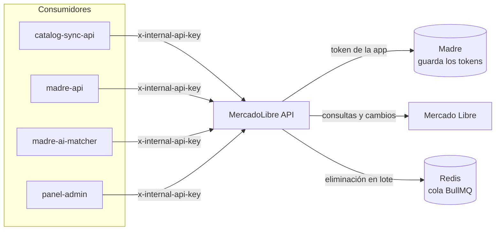

# MercadoLibre API

Microservicio interno de **Tienda Lo Quiero Acá** que hace de puerta de entrada a Mercado Libre para el resto de los sistemas.

Los demás servicios no hablan directo con Mercado Libre: le piden a este servicio las publicaciones, visitas, ventas, categorías y promociones, y este se encarga de autenticarse, respetar los límites de Mercado Libre y devolver los datos en un formato estable. También ejecuta los cambios que sí se hacen en Mercado Libre: cambiar un precio, eliminar publicaciones y sumar o sacar publicaciones de campañas.

## Qué hace

| | |
|---|---|
| **Publicaciones** | Lista las publicaciones de la cuenta y devuelve el detalle, la descripción y la comisión de cada una. |
| **Cambios en publicaciones** | Cambia el precio y elimina publicaciones, de a una o en lote (en segundo plano, con reintentos). |
| **Visitas** | Devuelve el total de visitas de cada publicación, de a una o en lote. |
| **Ventas** | Lista las ventas de la cuenta, en general o de una publicación. |
| **Categorías** | Devuelve el árbol de categorías de Mercado Libre Argentina. |
| **Promociones** | Consulta las campañas disponibles y suma o saca publicaciones de ellas. |
| **Credenciales** | Usa el token de Mercado Libre guardado en Madre y lo renueva solo antes de que venza. |

## Cómo funciona



Cada pedido pasa por los mismos pasos: se valida la clave interna, se obtiene un token vigente de Mercado Libre desde Madre (renovándolo si le faltan menos de 5 minutos), se consulta Mercado Libre y se traduce la respuesta. Si Mercado Libre limita por tasa, el servicio responde `429` con el tiempo de espera, en lugar de inventar un resultado.

El detalle de cada función está en la [guía funcional](docs/funcional.md).

## Ambientes

| Ambiente | URL base |
|---|---|
| Producción | `https://api.meli.loquieroaca.com` |
| Local | `http://localhost:8080` |

Además de los endpoints, el servicio publica tres herramientas:

| Herramienta | Ruta | Para qué |
|---|---|---|
| Documentación | `/docs` | Esta documentación, navegable y con buscador. |
| Swagger | `/api/docs` | Probar los endpoints desde el navegador. |
| Bull Board | `/admin/queues` | Ver el avance de las eliminaciones en lote. |

## Autenticación

Casi todos los endpoints piden el mismo header:

| Header | Valor |
|---|---|
| `x-internal-api-key` | La clave interna del servicio (`INTERNAL_API_KEY`). |

Sin el header la respuesta es `401 Internal API key missing`; con una clave incorrecta, `401 Invalid internal API key`.

Hay cuatro excepciones, abiertas porque devuelven datos que ya son públicos en Mercado Libre: las tres rutas de categorías y la descripción de una publicación. El detalle está en la [referencia de la API](docs/api.md#autenticación).

## Primer llamado

```bash
curl -s "https://api.meli.loquieroaca.com/meli/products/MLA1538120729" \
  -H "x-internal-api-key: $INTERNAL_API_KEY"
```

Devuelve el detalle de la publicación: título, precio, stock, estado, fotos y descripción.

## Documentación

**Funcional**

| Documento | Qué explica |
|---|---|
| [Guía funcional](docs/funcional.md) | Qué hace el servicio con publicaciones, visitas, ventas, categorías y promociones, y qué no hace. |
| [Errores y límites](docs/errores.md) | Qué responde ante cada error, qué significa y qué hacer, y los límites que impone Mercado Libre. |

**API**

| Documento | Qué explica |
|---|---|
| [Referencia de la API](docs/api.md) | Todos los endpoints con parámetros, valores por defecto, ejemplos y respuestas. |

**Técnico**

| Documento | Qué explica |
|---|---|
| [Arquitectura y configuración](docs/tecnico.md) | Capas del código, integraciones, la cola de eliminación, reintentos, variables de entorno y tests. |
| [Operación](docs/operacion.md) | Deploy, verificación y qué hacer ante los problemas más frecuentes. |

## Desarrollo local

Requisitos: Node.js 20 o superior y un Redis accesible.

```bash
npm install
cp .env.example .env    # completar las credenciales
npm run start:dev       # http://localhost:8080
```

> **Cuidado con el `.env`:** si apunta al Redis de producción, el servicio local también procesa la cola de eliminaciones de producción.

```bash
npm test                # tests unitarios
npm run lint            # eslint con --fix
npx tsc --noEmit        # chequeo de tipos
```

Para ver la documentación como sitio, sin levantar Redis ni el resto del servicio:

```bash
npm run docs:preview    # http://localhost:4310/docs
```

## Stack

NestJS 11 · TypeScript · BullMQ sobre Redis · Axios · Jest.
