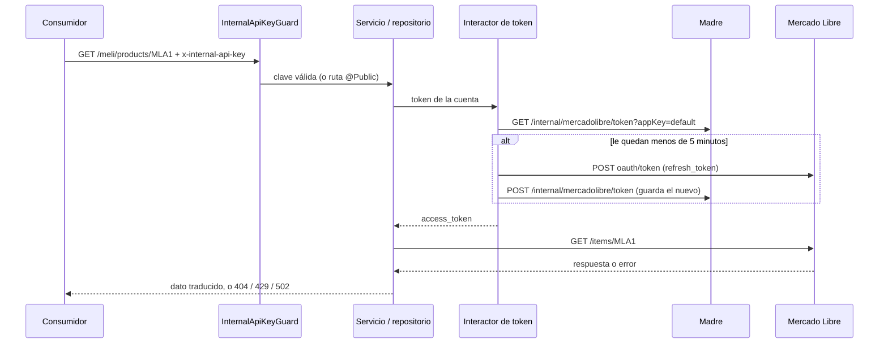

# Arquitectura y configuración

Cómo está armado el código, con qué servicios habla y cómo se configura.

← [Volver al inicio](../README.md)

**Contenido**

1. [Capas del código](#capas-del-código)
2. [Dónde está cada cosa](#dónde-está-cada-cosa)
3. [El recorrido de un pedido](#el-recorrido-de-un-pedido)
4. [Integraciones](#integraciones)
5. [La cola de eliminación](#la-cola-de-eliminación)
6. [Reintentos y memoria](#reintentos-y-memoria)
7. [El sitio de documentación](#el-sitio-de-documentación)
8. [Variables de entorno](#variables-de-entorno)
9. [Tests](#tests)
10. [Limitaciones conocidas](#limitaciones-conocidas)

---

## Capas del código

NestJS 11 con una separación por puertos y adaptadores: el código que habla con Mercado Libre y con Madre implementa interfaces, y los servicios dependen de esas interfaces, inyectadas por nombre (`'IMeliHttpClient'`, `'IMeliProductDetailRepository'`…).

```
src/
├── main.ts                  Arranque: Swagger, Bull Board y el sitio de documentación
├── config/                  Configuración de Swagger
├── core/                    Acceso a Mercado Libre y Madre
│   ├── entitis/             Tipos de dominio (publicación, venta, categoría, token…)
│   ├── adapters/            Interfaces de los repositorios y clientes HTTP
│   ├── drivers/             Implementaciones: clientes HTTP, repositorios, manejo de errores
│   └── interactors/         Casos de uso compartidos (obtener un token vigente)
└── app/                     Todo lo que es NestJS
    ├── controllers/         Endpoints: leen parámetros y delegan
    ├── services/            Validan la entrada y orquestan los repositorios
    ├── modules/             Módulos y providers: acá se cablea todo
    ├── guards/              Clave interna y el decorador @Public()
    ├── filters/             Traducción del 429 de Mercado Libre
    └── infra/               Cola de eliminación (BullMQ) y sitio de documentación
```

A diferencia de un hexágono estricto, `core/drivers` usa NestJS (`@Injectable`, excepciones HTTP): el manejo de errores de Mercado Libre decide ahí qué código HTTP responder.

**Regla práctica:** si un cambio es sobre *cómo* se habla con Mercado Libre (rutas, límites, formato de la respuesta), va en `core/drivers/repositories/mercadolibre`. Si es sobre *qué* se acepta o devuelve (validaciones, valores por defecto, memoria de visitas), en `app/services`. Si es sobre rutas, permisos o la cola, en `app`.

---

## Dónde está cada cosa

| Si hay que cambiar… | Archivo |
|---|---|
| Qué rutas son públicas | `@Public()` en el controller; el guard está en `app/guards/InternalApiKeyGuard.ts` |
| Cómo se traduce cada error de Mercado Libre | `core/drivers/repositories/mercadolibre/http/error/meliHttpError.ts` |
| El cliente HTTP de Mercado Libre (timeout, headers) | `core/drivers/repositories/mercadolibre/http/MeliHttpClient.ts` |
| Cuándo se renueva el token | `core/interactors/GetValidMeliAccessTokenInteractor.ts` |
| Credenciales de cada cuenta | `core/drivers/repositories/mercadolibre/config/MeliConfig.ts` |
| Vendedor de cada cuenta | `core/drivers/repositories/mercadolibre/getSeller/getMeliSellerId.ts` |
| Detalle, precio, eliminación y comisión | `core/drivers/repositories/mercadolibre/products/get/MeliProductDetailRepository.ts` |
| Listado de publicaciones y recorrido continuo | `core/drivers/repositories/mercadolibre/products/get/GetProductsRepository.ts` y `app/services/products/get/GetProductsService.ts` |
| Visitas: consultas a Mercado Libre | `core/drivers/repositories/mercadolibre/metrics/products/visits/GetProductsVisitRepository.ts` |
| Visitas: memoria de 30 minutos y tope del lote | `app/services/metrics/products/visits/meli-visitsService.ts` |
| Promociones | `core/drivers/repositories/mercadolibre/promotions/SellerPromotionsRepository.ts` |
| Ventas | `core/drivers/repositories/mercadolibre/orders/GetOrdersRepository.ts` |
| Detalle de venta y carrito | `core/drivers/repositories/mercadolibre/orders/GetOrderDetailRepository.ts` |
| Factura de una venta | `core/drivers/repositories/mercadolibre/orders/OrderInvoiceRepository.ts` |
| Cola de eliminación | `app/infra/queues/` |
| Sitio de documentación | `app/infra/docs/docs-site.router.ts` |

---

## El recorrido de un pedido



**Cómo se traduce cada respuesta de Mercado Libre** (`MeliHttpErrorHandler`):

| Mercado Libre responde | El cliente HTTP devuelve | Lo que ve el consumidor |
|---|---|---|
| `2xx` | El dato | `200` |
| `400`, `403`, `404` | `null`, con una línea `[MELI API] …` en el log | Según el endpoint: `404`, vacío u omitido |
| `429` | `MeliRateLimitException` | `429` con `Retry-After` (lo arma `MeliRateLimitFilter`) |
| Otro error, sin respuesta o más de 5 s | `BadGatewayException` | `502` |

Los métodos `putWithMeta`, `postWithMeta` y `deleteWithMeta` aceptan cualquier `4xx` como respuesta (solo tiran con `5xx`), para que el repositorio decida qué hacer con el rechazo. Así funcionan el cambio de precio, la eliminación y las promociones.

---

## Integraciones

| Servicio | Para qué | Autenticación | Timeout |
|---|---|---|---|
| Mercado Libre (`api.mercadolibre.com`) | Todos los datos | `Bearer` con el token de la cuenta | 5 s |
| Mercado Libre OAuth (`MELI_AUTH_URL`) | Renovar tokens | `client_id` + `client_secret` + `refresh_token` | 30 s |
| Madre (`MADRE_API_BASE_URL`) | Leer y guardar tokens en `/internal/mercadolibre/token` | `x-internal-api-key` (`MADRE_INTERNAL_API_KEY`) | `MADRE_API_TIMEOUT`, 30 s por defecto |
| Redis | Cola de eliminación (BullMQ) | Usuario y clave, TLS opcional | — |

Notas:

- **Madre guarda los tokens con un upsert vía `POST`**: guardar y actualizar son la misma llamada.
- **Las dos cuentas** se resuelven por `appKey`. `default` lee `MELI_*`; cualquier otra lee `MELI_<APPKEY>_*`, con el `appKey` en mayúsculas y los guiones convertidos en `_` (`promotions-engine-api` → `MELI_PROMOTIONS_ENGINE_API_*`).
- **El sitio de Mercado Libre está fijo en `MLA`** para categorías (`/sites/MLA/categories`) y comisiones (`/sites/MLA/listing_prices`).

---

## La cola de eliminación

| | |
|---|---|
| Nombre | `meli-product-delete` |
| Encola | `POST /meli/products/bulk/delete` (`MeliProductDeleteQueueService`) |
| Procesa | `MeliProductDeleteWorkerService`, en el mismo proceso que la API |
| Concurrencia | 1: una publicación a la vez |
| Intentos | 5, con espera exponencial desde 30 s |
| Id del job | `<batchId>-<itemId>`: el mismo lote no encola dos veces la misma publicación |
| Retención | Completados: 7 días o 1.000. Fallidos: 14 días o 5.000. |
| Panel | Bull Board en `/admin/queues` |

El worker marca como `UnrecoverableError` (no reintenta) los `4xx` definitivos, salvo `409` y `429`, y las publicaciones que no se pudieron leer.

**El Redis tiene que tener la política de memoria `noeviction`.** Con otra política, Redis puede borrar jobs de la cola cuando se queda sin memoria. BullMQ lo advierte al arrancar con `IMPORTANT! Eviction policy is … It should be "noeviction"`.

---

## Reintentos y memoria

| Dónde | Qué | Por qué |
|---|---|---|
| Eliminación de una publicación | Hasta 3 intentos, 1 s entre cada uno, ante `409` u *optimistic locking*. Espera 1 s después de finalizarla. | Mercado Libre tarda en reflejar el cambio de estado. |
| Publicaciones de una campaña | 2 intentos, 300 ms entre ellos, ante error. | Fallas pasajeras del endpoint de promociones. |
| Cola de eliminación | 5 intentos con espera exponencial. | Ver [La cola de eliminación](#la-cola-de-eliminación). |
| Token | Una sola renovación en curso por cuenta; los pedidos simultáneos la esperan. | Mercado Libre invalida el `refresh_token` al usarlo. |
| Visitas | Memoria de 30 minutos, hasta 50.000 publicaciones, solo de valores medidos. | Ahorrar consultas a Mercado Libre. |

Nada más reintenta: un `429` de Mercado Libre se devuelve al consumidor con `Retry-After` para que él decida cuándo volver.

La memoria de visitas y la renovación única de token viven **en el proceso**: se pierden al reiniciar y no se comparten si algún día hay más de una instancia.

---

## El sitio de documentación

`/docs` sirve el `README.md` y `docs/*.md` como sitio con [Docsify](https://docsify.js.org): menú lateral, buscador y diagramas Mermaid. Lo arma `createDocsSiteRouter` en `app/infra/docs/docs-site.router.ts`, montado en `main.ts`.

- **El markdown se lee del disco en cada visita.** Para publicar un cambio de texto alcanza con `git pull`: no hace falta compilar ni reiniciar.
- **Las rutas copian la estructura del repositorio**: el README en la raíz y el resto bajo `/docs/`. Así los enlaces relativos entre `.md` funcionan igual en el sitio y en GitHub.
- **Solo se sirven los archivos listados en `DOCS_PAGES`.** Nada más del repositorio se puede pedir por esta vía.
- **Sin usuario y clave queda abierto** y no publica la página de operación. Con `DOCS_SITE_USER` y `DOCS_SITE_PASSWORD` pide credenciales y publica todo.
- **Los títulos no pueden empezar con un número**: Docsify le antepone `_` al id, y el enlace funciona en GitHub pero no en el sitio.

Para verlo en local sin levantar el servicio: `npm run docs:preview` → `http://localhost:4310/docs`.

Para sumar una página: crear el `.md` en `docs/`, agregarlo a `DOCS_PAGES` y enlazarlo desde el README.

---

## Variables de entorno

### Servicio

| Variable | Por defecto | Descripción |
|---|---|---|
| `APP_PORT` | `8080` | Puerto HTTP. |
| `INTERNAL_API_KEY` | — | Clave interna que piden los endpoints y Bull Board. Sin ella responden `503`, salvo las rutas públicas. |

### Sitio de documentación

| Variable | Por defecto | Descripción |
|---|---|---|
| `DOCS_SITE_ENABLED` | `true` | `false` lo apaga. |
| `DOCS_SITE_PATH` | `/docs` | Ruta del sitio. |
| `DOCS_SITE_USER` | — | Con `DOCS_SITE_PASSWORD`, pide credenciales y publica la página de operación. |
| `DOCS_SITE_PASSWORD` | — | Ver la anterior. |

### Madre

| Variable | Por defecto | Descripción |
|---|---|---|
| `MADRE_API_BASE_URL` | — | Obligatoria: sin ella el servicio no arranca. |
| `MADRE_INTERNAL_API_KEY` | — | Obligatoria: sin ella el servicio no arranca. |
| `MADRE_API_TIMEOUT` | `30000` | En milisegundos. |

### Mercado Libre, cuenta principal

| Variable | Descripción |
|---|---|
| `MELI_AUTH_URL` | URL para renovar tokens (`https://api.mercadolibre.com/oauth/token`). |
| `MELI_CLIENT_ID` · `MELI_CLIENT_SECRET` | Credenciales de la aplicación. |
| `MELI_REDIRECT_URI` | Se lee pero no se usa: la renovación no la necesita. |
| `MELI_SELLER_ID` | Vendedor para el listado de publicaciones y las ventas. |

### Mercado Libre, cuenta de promociones

| Variable | Descripción |
|---|---|
| `MELI_PROMOTIONS_ENGINE_API_CLIENT_ID` · `…_CLIENT_SECRET` | Obligatorias para usar esta cuenta. |
| `MELI_PROMOTIONS_ENGINE_API_AUTH_URL` | Opcional: si falta, usa `MELI_AUTH_URL`. |
| `MELI_PROMOTIONS_ENGINE_API_REDIRECT_URI` | Opcional, no se usa. |
| `MELI_PROMOTIONS_ENGINE_API_SELLER_ID` | Vendedor para las campañas. |

### Redis

| Variable | Por defecto | Descripción |
|---|---|---|
| `REDIS_HOST` | — | Obligatoria: sin ella el servicio no arranca. |
| `REDIS_PORT` | `6379` | |
| `REDIS_USERNAME` · `REDIS_PASSWORD` | — | |
| `REDIS_TLS` | `false` | `true`, `1` o `yes` activan TLS. |

El archivo `.env.example`, en la raíz del repositorio, tiene la lista completa sin valores.

---

## Tests

```bash
npm test                 # unitarios
npx jest visits          # solo los que coinciden con "visits"
npx tsc --noEmit         # tipos
```

| Archivo | Qué cubre |
|---|---|
| `app/guards/InternalApiKeyGuard.spec.ts` | Clave correcta, faltante, incorrecta y rutas `@Public()`. |
| `app/guards/public-routes.spec.ts` | Con los controllers reales: qué rutas quedan abiertas y cuáles piden clave. |
| `app/infra/docs/docs-site.router.spec.ts` | El sitio: archivos permitidos, página restringida y credenciales. |
| `app/services/metrics/products/visits/meli-visitsService.spec.ts` | Memoria de visitas, ids omitidos, `404` individual. |
| `core/drivers/…/visits/GetProductsVisitRepository.spec.ts` | Una consulta por id, `429` a mitad del lote, `502` si no contestó ninguno. |
| `core/drivers/…/http/error/meliHttpError.spec.ts` | Traducción de `404`, `429` y `5xx`. |
| `core/interactors/GetValidMeliAccessTokenInteractor.spec.ts` | Una sola renovación de token con pedidos simultáneos. |

---

## Limitaciones conocidas

- **Un rechazo `400`/`403`/`404` de Mercado Libre se vuelve `null`.** Útil para "no existe", pero oculta otros motivos, incluido un `400` al renovar el token: en ese caso las consultas devuelven `404` o vacío en lugar de un error de permiso.
- **Sin validación de tipos en la entrada.** No hay `ValidationPipe` ni DTOs validados: un `limit=abc` llega como `NaN` a Mercado Libre.
- **Memoria de visitas en el proceso.** Se pierde al reiniciar y no se compartiría entre varias instancias.
- **Visitas de a una.** Mercado Libre acepta una publicación por consulta: recorrer todo el catálogo lleva lo que permite su límite por minuto (unas 69 horas para 1,2 millones de publicaciones).
- **Sitio fijo en `MLA`** para categorías y comisiones.
- **El test e2e es el de la plantilla de NestJS** (`test/app.e2e-spec.ts` espera `GET /` → `Hello World!`) y falla.
- **Quedan errores de lint previos**, en su mayoría `no-unsafe-*` por usar `any` con las respuestas de Mercado Libre.
- **El nombre de la carpeta `core/entitis`** tiene un error de tipeo que se mantiene para no romper los imports.
